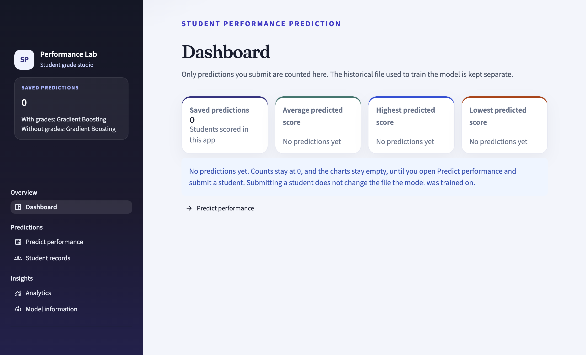
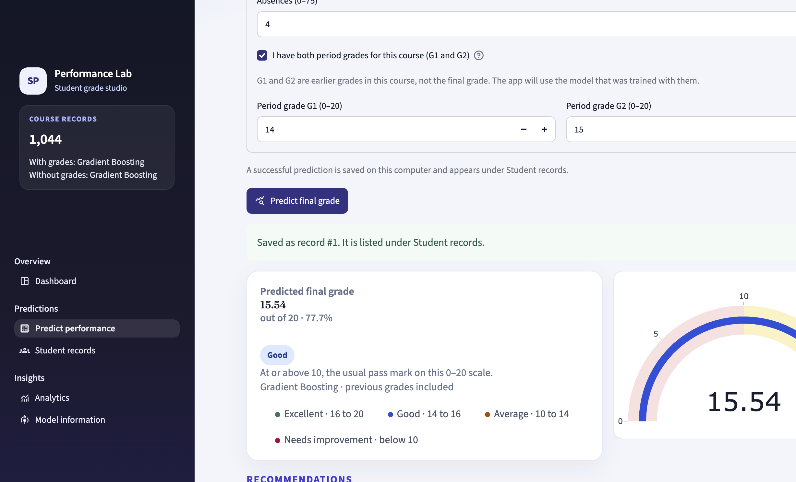

# Student Performance Prediction

A local web application that estimates a student's final course grade from the [UCI Student Performance](https://archive.ics.uci.edu/dataset/320/student+performance) dataset. You enter a student, the app scores a grade from 0 to 20, explains the result, and stores the prediction in SQLite.

The score is produced by a scikit-learn model that was trained on the real dataset. Metrics in this README come from that training run (`models/training_report.json`). They are not typed in by hand.

## Live App: [https://student-performance-vishal.streamlit.app](https://student-performance-vishal.streamlit.app)

## Features

- Dashboard with dataset size, saved-prediction statistics, grade distribution, and recent history.
- Prediction form with validation for age, absences, failures, names, and period grades.
- Two trained models: one that uses earlier period grades (G1 and G2), and one that does not.
- Performance category, score gauge, and recommendations written from the values you submitted.
- Student records: save, search, filter, open, and delete. Records stay on disk after the app restarts.
- Analytics charts for grades, study time, absences, parental education, model comparison, and actual versus predicted scores.
- Model page with dataset facts, the selected algorithm, train and test sizes, metrics, feature importance, and limitations.

## Technologies

| Area | Tools |
| --- | --- |
| Application | Python 3.13, Streamlit 1.67 |
| Charts | Plotly |
| Machine learning | pandas, NumPy, scikit-learn, joblib |
| Static chart | Matplotlib, Seaborn |
| Storage | CSV for the dataset, SQLite for saved predictions |

## Project structure

```
student-performance-prediction/
├── app.py                         # Streamlit entry point and navigation
├── requirements.txt
├── README.md
├── .gitignore
├── .streamlit/config.toml
├── data/
│   ├── raw/                       # Original UCI files
│   ├── student_data.csv           # Combined course table used for training
│   └── predictions.db             # Created locally; not committed
├── models/
│   ├── best_model.joblib          # Both trained pipelines
│   └── training_report.json       # Metrics from the last training run
├── src/
│   ├── config.py
│   ├── data_loader.py
│   ├── preprocessing.py
│   ├── train_model.py
│   ├── evaluation.py
│   ├── predict.py
│   ├── recommendations.py
│   ├── database.py
│   ├── charts.py
│   └── ui.py
├── pages/
│   ├── 1_Dashboard.py
│   ├── 2_Predict_Performance.py
│   ├── 3_Student_Records.py
│   ├── 4_Analytics.py
│   └── 5_Model_Information.py
├── assets/
│   ├── style.css
│   ├── training_comparison.png
│   └── screenshots/
└── tests/test_system.py
```

## Dataset

Source: Paulo Cortez and Alice Silva, *Using Data Mining to Predict Secondary School Student Performance*, FUBUTEC 2008. Published by the UCI Machine Learning Repository:

https://archive.ics.uci.edu/dataset/320/student+performance

The repository ships two semicolon-separated files. This project keeps both:

- `student-mat.csv`: 395 mathematics rows
- `student-por.csv`: 649 Portuguese rows
- Combined table: 1,044 course records, 0 missing cells

The authors report that 382 students appear in both files. Both rows are kept. Each prediction is a course grade, identified by the course field. It is not a combined GPA.

The original files are in `data/raw/`. `data/student_data.csv` is the comma-separated table the app trains on. The UCI archive does not include a simple SPDX license line. Use the files under the repository's own terms, and cite Cortez and Silva if you present the work.

The target is `G3`, the final grade on a 0–20 scale. `G3` is never an input. `G1` and `G2` are earlier grades in the same course. They are used only when you say both grades are available.

## How the prediction works

1. The form checks the name and the numeric ranges (age 15–22, failures 0–3, absences 0–75, grades 0–20).
2. The app chooses a pipeline:
   - **With previous grades** when both G1 and G2 are entered.
   - **Without previous grades** otherwise. Missing period grades are not filled in with guesses.
3. A scikit-learn `Pipeline` with a `ColumnTransformer` prepares the row:
   - Numbers are median-imputed. Linear models also standardize them. Trees do not.
   - Categories are filled with the most frequent training value and one-hot encoded. Unknown categories are ignored.
   - Imputers and the encoder are fit only on the training split, inside the pipeline.
4. The saved model returns a number. The app clips it to 0–20 and rounds it to two decimals.
5. The category uses that displayed score:
   - Excellent: 16 to 20
   - Good: 14 up to 16
   - Average: 10 up to 14
   - Needs Improvement: below 10
6. Recommendations read the submitted study time, absences, failures, support flags, and the predicted score. Absences are compared with the dataset median and 75th percentile.

### Training

The same 80/20 split is used for both feature sets: shuffled, stratified by course, `random_state=42`. That split is 835 training rows and 209 test rows.

Candidates are Linear Regression, Ridge, Random Forest, and Gradient Boosting. Each model (except plain linear regression) is tuned with 5-fold cross-validation on the training rows only. The deployed model is the one with the lowest mean cross-validated RMSE. The test set is scored once after that choice.

On this run, Gradient Boosting won when previous grades are included. Random Forest won when they are not. School is not an input.

### Results from the saved training run

**With previous grades** — Gradient Boosting, `learning_rate=0.05`, `max_depth=2`.

| | MAE | MSE | RMSE | R² |
| --- | ---: | ---: | ---: | ---: |
| Cross-validation | 0.917 | 2.089 | 1.435 | 0.861 |
| Held-out test | 0.812 | 2.061 | 1.436 | 0.845 |

G2 accounts for most of this model's importance (about 0.88), then absences and G1. A strong score here mostly means the earlier period grades were already strong.

**Without previous grades** — Random Forest, `max_depth=16`, `min_samples_leaf=4`.

| | MAE | MSE | RMSE | R² |
| --- | ---: | ---: | ---: | ---: |
| Cross-validation | 2.370 | 10.581 | 3.246 | 0.303 |
| Held-out test | 2.264 | 9.716 | 3.117 | 0.267 |

The largest importances are past failures, absences, course, age, study time, and mother's education. This estimate is much less precise. Use it before period grades exist, and treat it as a rough signal.

Comparison of every candidate is on the Model information page, and in `models/training_report.json`. Analytics charts only the predictions you save.

## Installation

From the project folder:

```bash
python3 -m venv .venv
source .venv/bin/activate
pip install -r requirements.txt
```

The prepared dataset and the trained model are already in the project. To train again:

```bash
python -m src.train_model
```

Training rewrites `models/best_model.joblib`, `models/training_report.json`, and `assets/training_comparison.png`. It does not delete saved predictions.

If those model files are missing, open the app and use **Train the model now**.

## Run the application

```bash
source .venv/bin/activate
streamlit run app.py
```

Streamlit prints a local URL, usually http://127.0.0.1:8501.

The prediction database starts empty. Open **Predict performance**, enter a student (or click **Use sample student** to fill the form), then click **Predict final grade**. The score is calculated by the model and saved only after you submit. That save does not change the training file.

## Screenshots

Dashboard before any prediction has been saved. The counts are zero because they come only from predictions you submit.



Prediction result for the sample student, including the score, category, and the start of the recommendations.



## Tests already run

`python -m unittest tests.test_system -v` — 10 tests, all passed. The suite builds the dataset, trains both models, checks that the selected model has the lowest cross-validated RMSE, rejects invalid inputs, and checks SQLite save, search, filter, delete, and persistence.

The running app was also exercised in the browser:

- Empty name was rejected and nothing was saved.
- The sample student was scored at 15.54 and saved as record 1.
- Category filter **Excellent** showed 0 of 1, with an empty-state message. **All** restored the record.
- A second prediction was saved and then deleted. One record remained.
- Analytics shows only saved predictions. With an empty database it stays empty. After one save it plotted that prediction, not the Math and Portuguese training file.
- Model information showed Gradient Boosting, 835 / 209 rows, and test R² 0.845.
- After stopping and starting Streamlit, record 1 (Maria Costa, 15.54) was still there.
- The dashboard then reported average, highest, and lowest as 15.54 from saved predictions.

## Limitations

- The grade scale and the students belong to two Portuguese secondary schools in 2005–2006. A prediction is not a GPA and is not a grade from another school or year.
- When G1 and G2 are available, they dominate the score. The model without them explains much less of the variation (test R² about 0.27).
- Some recorded final grades are 0. In the original study, extreme absences can force a zero. Another school may not use that rule.
- The form stops at 75 absences because that is the highest value in this file.
- Weekday and weekend alcohol use, and parent occupation, are in the source file and are not model inputs.
- This is a statistical estimate from about a thousand course records. Do not use it as the only basis for placement, discipline, or admissions.

## Future improvements

- Add a confidence interval or prediction interval next to the point score.
- Let a teacher import a class CSV and download the scored file.
- Add sign-in if more than one person will share the same computer.
- Retrain when a newer public dataset with the same columns is available, and keep the old report for comparison.
